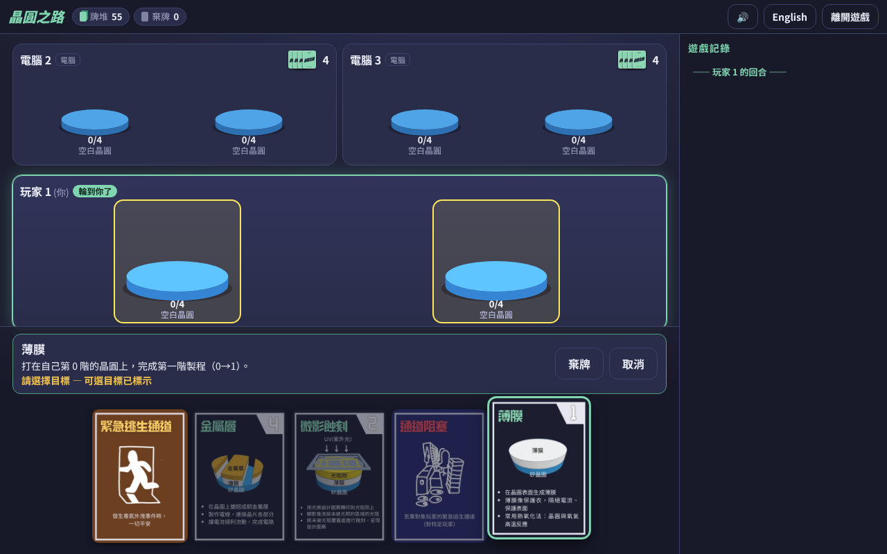

# 晶圓之路 Wafer Road

[繁體中文](#繁體中文) · [English](#english)



**線上遊玩 / Play online: https://boenchen1112.github.io/wafer-road/**

---

## 繁體中文

**晶圓之路**是一款以半導體製程為主題的策略卡牌遊戲（適合 9 歲以上、2～5 人）。這是它的網頁數位版：可以和電腦對戰，或多位真人共用同一台裝置輪流遊玩，手機與電腦皆可使用。

打造晶片的任務開始了！你能率先完成晶圓的製程，成為半導體之星嗎？小心災難突襲——毒氣外洩、大停電、新進工程師，可能一夕之間逆轉戰局！

### 本機執行

```bash
npm install
npm run dev       # 開發伺服器
npm test          # 單元測試與大量隨機對局測試
npm run build     # 型別檢查並建置到 dist/
npm run preview   # 預覽建置結果
```

需要 Node.js 20 以上。部署：推送到 `main` 後，GitHub Actions 會自動建置並發佈到 GitHub Pages。

### 規則摘要

- 每位玩家有 2 片晶圓（第 0 階），起手 4 張牌；牌堆共 68 張。
- 每回合：抽 1 張 → 打出 1 張牌**或**棄 1 張牌 → 手牌回到 4 張。
- 製程卡只能打在**自己的**晶圓上，且必須是剛好的下一階：薄膜 ×12（0→1）、微影蝕刻 ×9（1→2）、摻雜 ×7（2→3）、金屬層 ×5（3→4，晶圓完成）；晶圓代工 ×3 為萬用卡。
- 退回卡可打在任何玩家（含自己）的晶圓上，且晶圓必須剛好在該階：設備老舊 ×4（1→0）、曝光量錯誤 ×3（2→1）、離子佈植問題 ×2（3→2）。已完成的晶圓不受任何影響。
- 事件：大停電 ×4（所有玩家；沒有發電機者所有晶圓倒退 1 步，有發電機者改棄 1 張發電機）、毒氣外洩 ×4（指定 1 名玩家倒退 1 步，有逃生通道則改棄 1 張）。
- 災難：新進工程師 ×2（使對手棄 1 張發電機）、通道阻塞 ×2（使對手棄 1 張逃生通道）。
- 保護：發電機 ×4、逃生通道 ×4，面朝上放在自己面前，可疊加，每張擋 1 次對應事件後棄置。
- 功能：年終獎金 ×3 — 抽 2 張，然後打出 1 張再棄 1 張，或直接棄 2 張。
- 結束方式：**限時**（預設）最先完成 1 片晶圓者獲勝；牌堆用完則進行最終回合（每人再一回合）並計分（第 1/2/3 階 = 2/3/4 分，兩片相加，手上每張年終獎金 +1 分）。**長局**：牌堆用完時重洗棄牌堆，直到有人完成 1 片晶圓。

完整規則與卡牌圖鑑請見遊戲內的「如何遊玩」，以及依說明書整理的「製程原理」頁面。

### 專案結構

- `src/engine/` — 純函式、可決定性（seed）的遊戲引擎，無 DOM；`createGame`、`legalActions`、`applyAction`。可在伺服器上以同一份程式碼運行（日後線上多人）。
- `src/ai/` — 電腦玩家（簡單／普通），只呼叫引擎 API。
- `src/ui/`、`src/i18n/`、`src/audio/` — Preact 介面、繁中／英文字典、WebAudio 合成音效。
- `tests/` — Vitest：每張卡的效果、保護、結束條件、計分，以及數千局隨機對局的 fuzz 測試。
- `scripts/e2e.mjs` — Playwright 自動遊玩並截圖（`npm run build && node scripts/e2e.mjs`）。

### 製作名單

- 遊戲名稱：晶圓之路
- 遊戲類型：教育策略卡牌遊戲
- 設計主題：半導體製程
- 設計團隊：龔書宏、張容瑄、黃昱誠、陳博恩、沈虹
- 特別感謝：清華大學 洪秉驊
- 贊助單位：科林研發 (Lam Research) 半導體AI科學營

### 授權

程式碼採 [MIT 授權](LICENSE)（Daniel Chen (陳博恩) 與晶圓之路設計團隊）。**卡牌圖像、科林研發 (Lam Research) 標誌與品牌素材不在 MIT 範圍內**，著作權由各權利人保留，經授權使用，詳見 [ASSETS.md](ASSETS.md)。

---

## English

**Wafer Road (晶圓之路)** is a semiconductor-themed strategy card game for 2–5 players, ages 9+. This is its web version: play against bots, or pass one device around between several humans. It works on phones and desktops.

The chip-making mission begins! Can you be the first to finish a wafer and become the star of semiconductors? Beware of disasters — Toxic Gas Leak, Blackout and Rookie Engineer can turn the game around overnight!

### Run locally

```bash
npm install
npm run dev       # dev server
npm test          # unit tests + thousands of fuzzed bot games
npm run build     # type-check and build into dist/
npm run preview   # preview the production build
```

Requires Node.js 20+. Deployment: pushing to `main` builds and publishes to GitHub Pages through GitHub Actions.

### Rules summary

- Each player has 2 wafers (step 0) and starts with 4 cards; the deck has 68 cards.
- Each turn: draw 1 → play 1 card **or** discard 1 card → hand is back to 4.
- Process cards go on **your own** wafers and only as the exact next step: Thin Film ×12 (0→1), Photolithography & Etch ×9 (1→2), Doping ×7 (2→3), Metallization ×5 (3→4, wafer complete); Foundry ×3 is wild.
- Regression cards may target any player's wafer (yours too) that is at exactly the required step: Aging Equipment ×4 (1→0), Exposure Error ×3 (2→1), Ion Implant Issue ×2 (3→2). Completed wafers are immune to everything.
- Events: Blackout ×4 (every player; without a Generator all wafers go back 1 step, with one you discard a Generator instead), Toxic Gas Leak ×4 (one player goes back 1 step unless they discard an Emergency Exit).
- Disasters: Rookie Engineer ×2 (opponent discards a Generator), Blocked Exit ×2 (opponent discards an Emergency Exit).
- Protection: Generator ×4, Emergency Exit ×4 — placed face-up, stackable, each blocks one matching event then is discarded.
- Function: Year-End Bonus ×3 — draw 2, then play 1 and discard 1, or discard 2.
- Ending: **Timed** (default) — first to complete a wafer wins; if the deck runs out there is a final round (everyone gets one more turn) and scoring (step 1/2/3 = 2/3/4 pts, both wafers summed, +1 per Year-End Bonus in hand). **Long game** — the discard pile is reshuffled when the deck runs out, until someone completes a wafer.

The full rules and a card reference are in the in-game "How to Play" page, plus a "Process Principles" page based on the booklet.

### Project layout

- `src/engine/` — pure, deterministic (seeded) game engine with no DOM: `createGame`, `legalActions`, `applyAction`. The same code can later run on a server for online multiplayer.
- `src/ai/` — bots (Easy / Normal) that only call the engine API.
- `src/ui/`, `src/i18n/`, `src/audio/` — Preact UI, zh-TW / en dictionaries, WebAudio-synthesised sound.
- `tests/` — Vitest: every card effect, protection, end conditions, scoring, and a fuzz test over thousands of random games.
- `scripts/e2e.mjs` — Playwright script that plays games and takes screenshots (`npm run build && node scripts/e2e.mjs`).

### Credits

- Game: 晶圓之路 (Wafer Road) — educational strategy card game, theme: semiconductor processes
- Design team: 龔書宏, 張容瑄, 黃昱誠, 陳博恩 (Daniel Chen), 沈虹
- Special thanks: National Tsing Hua University — 洪秉驊
- Sponsor: Lam Research (科林研發) Semiconductor AI Science Camp

### License

Code is released under the [MIT License](LICENSE) (Daniel Chen (陳博恩) and the 晶圓之路 design team). **The card art, the Lam Research logo and branding are not covered by MIT**; they remain the property of their owners and are used with permission — see [ASSETS.md](ASSETS.md).
